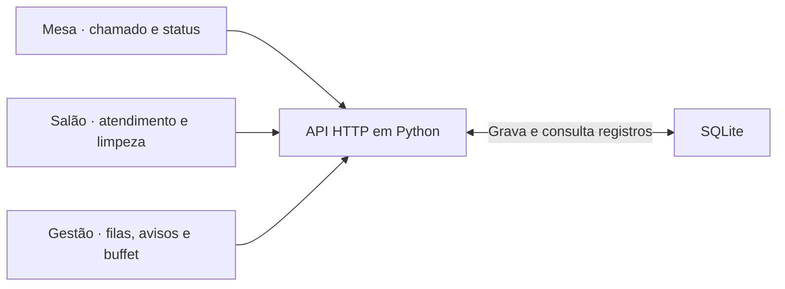

# Mesa Atenta

Painel para acompanhar o almoço da Bovinu’s Grill & Beer, unidade Augusta. O cliente pode solicitar atendimento na mesa. A equipe acompanha tarefas de atendimento e limpeza. O gerente registra medições, recebe avisos de fila e acompanha as observações sobre o buffet.

## Entrega · Hackathon Tech FMU 2026.2

- **Vídeo da solução (1min09):** [Assistir sem login](https://mesa-atenta-hackathon.vercel.app/video-demo) · [MP4 no GitHub](public/mesa-atenta-demo.mp4). Mesa-Tempo a partir de 0:47.
- **Apresentação de 5 slides:** [PDF](docs/apresentacao.pdf) · [PowerPoint com vídeo incorporado](docs/pitch.pptx) · [Roteiro](docs/roteiro-pitch.txt).
- **Demo online:** [Mesa 07](https://mesa-atenta-hackathon.vercel.app/mesa?mesa=07) · [Salão](https://mesa-atenta-hackathon.vercel.app/equipe) · [Gestão](https://mesa-atenta-hackathon.vercel.app/gestao).
- **Cinco capturas:** [pedido da Mesa 07](docs/capturas/01-mesa-chamado.png) · [chamado assumido](docs/capturas/02-salao-atendimento.png) · [atendimento concluído](docs/capturas/03-mesa-concluida.png) · [limpeza da Mesa 12](docs/capturas/04-salao-limpeza.png) · [Gestão](docs/capturas/05-gestao.png).

| Dor | Fluxo | Tela |
|---|---|---|
| Espera no buffet, churrasqueira e mesas | Registra contagem e tempo cronometrado separadamente. A gestão confirma o aviso, registra a ação e compara a mediana de espera. O cliente acompanha o chamado da mesa. | Gestão, Salão e Mesa |
| Limpeza | Sinaliza a mesa, assume a limpeza e marca a mesa pronta. O relógio começa na sinalização. | Salão |
| Mix do prato | Registra gramas de carne e outros alimentos de uma pesagem amostral e calcula a participação de carne no peso total. | Gestão |
| Qualidade percebida | Registra sobras por item, comentários com local da coleta e ações do gerente. Compara a proporção de sobras antes e depois de uma ação do mesmo item. | Gestão |

## Executar

O MVP local requer Python 3.10+ e usa somente a biblioteca padrão. O piloto de câmera tem dependências opcionais.

```sh
python3 app.py
```

- Entrada: http://127.0.0.1:8000/ (abre Gestão)
- Mesa 07: http://127.0.0.1:8000/mesa?mesa=07
- Salão: http://127.0.0.1:8000/equipe
- Gestão: http://127.0.0.1:8000/gestao

Nenhuma variável é obrigatória. `PORT` altera a porta padrão 8000. `MESA_DB` define o caminho do SQLite. No Windows, use `py app.py`. O servidor padrão escuta apenas em localhost. A versão local usa as mesmas telas da Vercel, com uma API Python e SQLite no lugar do Supabase. Os dados são compartilhados entre janelas conectadas ao mesmo servidor local; não há autenticação.

Para começar com dados **simulados** em um banco novo, execute:

```sh
python3 seed_demo.py demo.sqlite3
MESA_DB=demo.sqlite3 python3 app.py
```

No PowerShell, defina `$env:MESA_DB='demo.sqlite3'` antes de executar `py app.py`. O comando de carga recusa sobrescrever um banco existente. Execute a carga pouco antes da demonstração para manter as leituras recentes.

## Prévia no Sites

[Abrir a prévia privada do Mesa Atenta](https://mesa-atenta-augusta.oliverr-biahh10.chatgpt.site). A prévia guarda dados simulados no navegador. O projeto executado pelos comandos acima usa a API Python e o SQLite.

### Prévia na Vercel

[Abrir a implantação pública na Vercel](https://mesa-atenta-hackathon.vercel.app).

A pasta `public/` contém a demonstração estática implantada na Vercel. As telas
compartilham uma sessão no Supabase/PostgreSQL e recebem atualizações pelo Realtime.
O controle otimista de versão evita que duas ações simultâneas sobrescrevam o estado.

O publishable key do Supabase é público por definição; nenhuma `service_role` é enviada
ao navegador. O esquema, os grants explícitos e as políticas RLS estão em
`supabase/migrations/`. A política atual é exclusiva da sessão pública da demo. Antes de
uso real, adicione autenticação da equipe e políticas por função/unidade.

## Desenvolvimento e integração



A base do atendimento foi preservada. A segunda etapa acrescentou limpeza com transições persistidas, medições e avisos por local, registros do buffet e comparação de amostras. As telas consultam a API automaticamente a cada poucos segundos. O esquema é criado pelo código em `app.py` e `operations.py`. Os reenvios usam uma chave idempotente.

Por padrão, um aviso abre depois de duas ou mais contagens compatíveis com acúmulo, separadas por pelo menos 45 s, sem intervalo maior que 90 s. O limite padrão é 8 pessoas por local e pode ser ajustado. A recuperação requer contagens abaixo do limite pelo mesmo período. A interface sinaliza leitura desatualizada após 90 s. A comparação de espera usa amostras cronometradas e mostra a mediana e o tamanho da amostra. São comparações descritivas da demo.

A numeração em três áreas é ilustrativa. O endereço da tela da mesa pode ser codificado no QR. A comanda eletrônica do restaurante continua registrando as bebidas. A versão local usa entrada manual para contagem e pesagem. Botões de amostra preenchem exemplos simulados de fila, pesagem e limpeza. A equipe confirma antes de salvar. Comentários recebem sugestões por palavras-chave. A demo publicada não executa visão computacional nem reconhecimento de pratos.

### Mesa-Tempo: contagem por câmera (piloto local)

O piloto faz parte do Mesa Atenta e usa o detector pré-treinado HOG/SVM do [OpenCV](https://docs.opencv.org/4.x/d5/d33/structcv_1_1HOGDescriptor.html). Em vídeo de teste, detectou duas pessoas e registrou a contagem no painel de Gestão local. Não grava imagens, não reconhece rostos e não calcula o tempo de espera. A câmera da unidade ainda não foi conectada; um piloto real depende de acesso autorizado e validação no local. A versão hospedada não executa o detector.

Consulte [código e instruções do Mesa-Tempo](vision/README.md) e [demonstração, entrega e testes](docs/DEMO.md).

### Verificação pelo navegador

Com um banco de demonstração recém-criado e o servidor na porta 8765, execute
`MESA_URL=http://127.0.0.1:8765 node tests/verify_ui.cjs` em um ambiente com
Playwright e Chromium. Use `CHROMIUM` para informar uma instalação de Chromium
alternativa e `MESA_EVIDENCE` para salvar até cinco capturas. O teste usa três
contextos independentes e altera o banco usado pelo servidor: não aponte o teste para
o ambiente de produção nem para uma sessão compartilhada com avaliadores.
