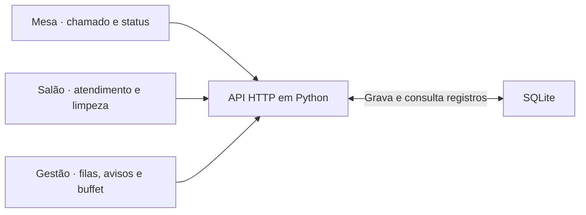

# Mesa Atenta

Painel para acompanhar o almoço da Bovinu’s Grill & Beer, unidade Augusta. O cliente pode solicitar atendimento na mesa. A equipe acompanha tarefas de atendimento e limpeza. O gerente registra medições, recebe avisos de fila e acompanha as observações sobre o buffet.

| Dor | Fluxo | Tela |
|---|---|---|
| Espera no buffet, churrasqueira e mesas | Registra contagem e tempo cronometrado separadamente. A gestão confirma o aviso, registra a ação e compara a mediana de espera. O cliente acompanha o chamado da mesa. | Gestão, Salão e Mesa |
| Limpeza | Sinaliza a mesa, assume a limpeza e marca a mesa pronta. O relógio começa na sinalização. | Salão |
| Mix do prato | Registra gramas de carne e outros alimentos de uma pesagem amostral e calcula a participação de carne no peso total. | Gestão |
| Qualidade percebida | Registra sobras por item, comentários com local da coleta e ações do gerente. Compara a proporção de sobras antes e depois de uma ação do mesmo item. | Gestão |

## Executar

Requer Python 3.10+ e usa somente a biblioteca padrão.

```sh
python3 app.py
```

- Mesa 07: http://127.0.0.1:8000/?mesa=07
- Salão: http://127.0.0.1:8000/equipe
- Gestão: http://127.0.0.1:8000/gestao

Nenhuma variável é obrigatória. `PORT` altera a porta padrão 8000. `MESA_DB` define o caminho do SQLite. No Windows, use `py app.py`. O servidor padrão escuta apenas em localhost. As três telas compartilham o mesmo banco em modo demonstração local, sem autenticação.

Para começar com dados **simulados** em um banco novo, execute:

```sh
python3 seed_demo.py demo.sqlite3
MESA_DB=demo.sqlite3 python3 app.py
```

No PowerShell, defina `$env:MESA_DB='demo.sqlite3'` antes de executar `py app.py`. O comando de carga recusa sobrescrever um banco existente. Execute a carga pouco antes da demonstração para manter as leituras recentes.

## Prévia no Sites

[Abrir a prévia privada do Mesa Atenta](https://mesa-atenta-augusta.oliverr-biahh10.chatgpt.site). A prévia guarda dados simulados no navegador. O projeto executado pelos comandos acima usa a API Python e o SQLite.

### Prévia na Vercel

[Abrir a implantação pública na Vercel](https://mesa-atenta-hackathon.vercel.app).

A pasta `public/` contém a mesma demonstração estática para implantação na Vercel.
Ela persiste dados simulados no navegador e não substitui o backend Python/SQLite.
Para uma implantação multiusuário, a persistência deve migrar para PostgreSQL/Supabase.

## Desenvolvimento e integração



A base do atendimento foi preservada. A segunda etapa acrescentou limpeza com transições persistidas, medições e avisos por local, registros do buffet e comparação de amostras. As telas consultam a API automaticamente a cada poucos segundos. O esquema é criado pelo código em `app.py` e `operations.py`. Os reenvios usam uma chave idempotente.

Por padrão, um aviso abre depois de duas ou mais contagens compatíveis com acúmulo, separadas por pelo menos 45 s, sem intervalo maior que 90 s. O limite padrão é 8 pessoas por local e pode ser ajustado. A recuperação requer contagens abaixo do limite pelo mesmo período. A interface sinaliza leitura desatualizada após 90 s. A comparação de espera usa amostras cronometradas e mostra a mediana e o tamanho da amostra. São comparações descritivas da demo.

A numeração em três áreas é ilustrativa. O endereço da tela da mesa pode ser codificado no QR. A comanda eletrônica do restaurante continua registrando as bebidas. A versão local usa entrada manual para contagem e pesagem. A captura por câmera e a análise por IA permanecem como possibilidades de evolução.

Consulte [roteiro, checklist e testes](docs/DEMO.md) e [apresentação](docs/apresentacao.pdf).
